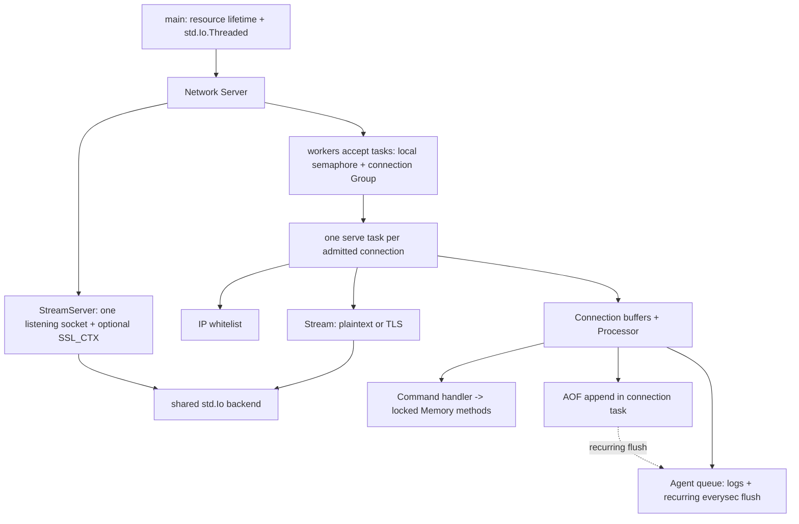
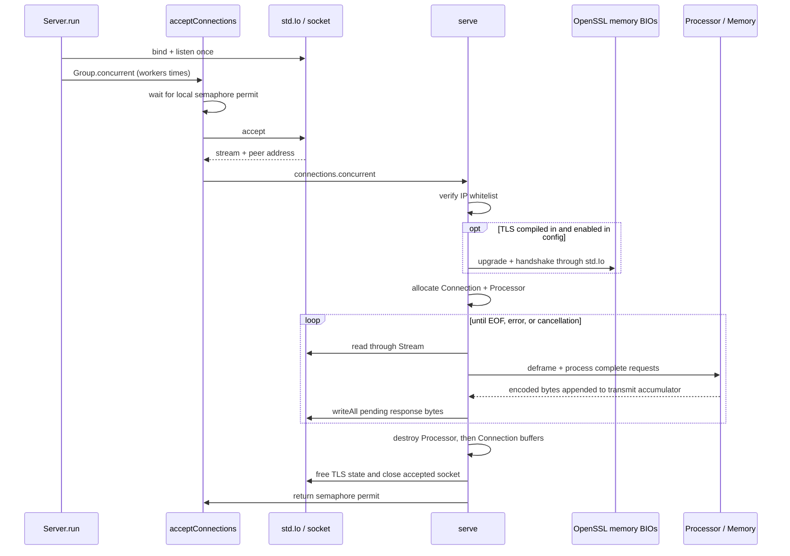

# Network architecture

This document describes the implemented network path, not a proposed event-loop
design. The runtime uses Zig 0.17.1 `std.Io.Threaded`; TLS is implemented with
OpenSSL memory BIOs. All application-controlled socket reads and writes use the
shared `std.Io` backend.

## Contents

- [Component boundaries](#component-boundaries)
- [Tasks, threads, and ownership](#tasks-threads-and-ownership)
- [Connection lifecycle](#connection-lifecycle)
- [Request and response flow](#request-and-response-flow)
- [Copy and allocation inventory](#copy-and-allocation-inventory)
- [TLS transport](#tls-transport)
- [Admission control and backpressure](#admission-control-and-backpressure)
- [Errors and shutdown](#errors-and-shutdown)
- [Implementation constraints](#implementation-constraints)
- [Verification and maintenance](#verification-and-maintenance)

## Component boundaries

| Component | Responsibility | Source |
| --- | --- | --- |
| Process entry point | Creates the I/O backend and shared resources; installs signal handlers; coordinates teardown. | [main.zig](../../src/main.zig) |
| Network `Server` | Supervises accept tasks, owns their shared transport, checks access, and runs connection tasks. | [network/server.zig](../../src/server/network/server.zig) |
| `StreamServer` | Owns the listening socket and optional shared TLS context; binds, accepts, and upgrades streams. | [stream_server.zig](../../src/server/network/stream_server.zig) |
| `Stream` / `StreamT` | Presents the same read/write/close API for plaintext and TLS; also exposes a buffered `std.Io.Reader` adapter. | [stream.zig](../../src/server/network/stream.zig) |
| Socket adapter | Uses `std.Io.net.Stream.read` and `std.Io.operate` network operations; handles partial writes. | [socket.zig](../../src/server/network/socket.zig) |
| TLS adapter | Drives handshakes, encryption, and decryption through OpenSSL input/output memory BIOs. | [secure.zig](../../src/server/network/secure.zig) |
| `Connection` | Owns receive/transmit accumulators and a fixed read buffer. | [connection.zig](../../src/server/network/connection.zig) |
| `Processor` | Extracts complete frames, parses commands, encodes responses, and compacts unread bytes. | [requests.zig](../../src/server/processing/requests.zig) |
| Command handler and storage | Execute commands synchronously in the connection task; storage methods provide their own locking. | [commands.zig](../../src/server/processing/commands.zig), [memory.zig](../../src/server/storage/memory.zig) |
| Access policy | Stateless IP whitelist verification, including rejection logging. | [access.zig](../../src/server/middleware/access.zig) |
| Background `Agent` | Serializes queued log work and recurring AOF flushes on an existing database background thread. | [agent.zig](../../src/server/background/agent.zig), [logger.zig](../../src/server/logger.zig), [aof.zig](../../src/server/storage/aof.zig) |

The network supervisor and former listener responsibilities live together:
there is no separately allocated array of listener objects. `StreamServer`
remains separate because socket/TLS lifecycle is reusable independently of
request processing. `Context` contains references to shared resources; copying
it does not copy the database, logger, or background queue.



Arrows describe calls or task creation, not transfers of ownership. The queue
arrow for AOF represents its scheduled flush, not command dispatch.

## Tasks, threads, and ownership

`main` creates one `std.Io.Threaded` instance and publishes its `std.Io` through
[runtime/io.zig](../../src/runtime/io.zig). Unit tests instead obtain
`std.testing.io` from the same adapter.

`Server.run` binds once, then starts `config.workers` concurrent accept tasks
using `std.Io.Group.concurrent`. These tasks accept from the **same** listening
socket. Each accept task has a local `std.Io.Semaphore` and a local group of
connection tasks. It cancels and waits for that group before returning, so the
semaphore cannot disappear while a connection still references it.

```text
main / Server.run
  owns StreamServer
  owns workers Group
    +-- acceptConnections #0
    |     owns semaphore #0
    |     owns connections Group #0
    |       +-- serve connection A
    |       +-- serve connection B
    +-- acceptConnections #1
    |     owns semaphore #1
    |     owns connections Group #1
    |       +-- serve connection C
    +-- ... up to config.workers accept tasks

separate existing Agent drain thread
  consumes immediate log tasks and delayed AOF flush tasks
```

This is task-based structured concurrency, **not** an `epoll`/`kqueue` reactor
implemented by the application. With the currently selected threaded backend,
blocked accepts, reads, writes, and TLS handshakes can occupy operating-system
threads. `workers` counts accept tasks, not a fixed-size pool that bounds all
network threads. There is no application-configured `Threaded` concurrency cap;
do not infer scalability or throughput from the API shape alone.

The database queue is also not a global serialization point for client
commands. Different connections execute commands concurrently in their own
tasks, calling storage methods directly.

### Ownership rules

| Resource | Owner and lifetime |
| --- | --- |
| Listening socket and shared `SSL_CTX` | `StreamServer`, owned by the network server; destroyed after its accept/connection groups finish. |
| Accepted socket and per-connection `SSL` / BIOs | The `accepted.stream` local in `serve`; closed on every exit path. |
| Stream value inside `Connection` | A shallow handle/context copy used for I/O, not a second resource owner. `Connection.deinit` frees buffers only. |
| Receive and transmit arrays | `Connection`; created after admission and TLS upgrade, freed when `serve` exits. |
| Parsing and encoding arenas | The connection's `Processor.protocol`; destroyed with the processor. |
| Semaphore permit | Reserved before `accept`; held through access verification, handshake, processing, and teardown. |
| Logger task arguments | Queue-owned copies; string slice arguments are duplicated by the scheduler's existing cloning path. |
| AOF scheduled callback | Non-owning AOF pointer protected by a cancelable task handle; cancellation waits for an executing callback. |

Passing `Stream`, addresses, or `Context` by value copies metadata and pointers,
not their underlying byte buffers.

## Connection lifecycle



Admission happens before allocating protocol buffers. Whitelist verification
also precedes TLS handshake work. A failed connection-task spawn explicitly
closes the accepted stream and returns its permit.

TLS is selected for the entire listening socket: a TLS-capable binary with TLS
disabled uses plaintext. There is no STARTTLS command, protocol sniffing, or
simultaneous plaintext/TLS negotiation on one listener. The server initializes
TLS only when both the build option and runtime configuration enable it.

## Request and response flow

### Framing and ordering

The transport is a TCP byte stream, not a message transport. The outer frame
delimiter is `EXT_CHAR`, byte `0x03`, defined in
[network/consts.zig](../../src/server/network/consts.zig). For example:

```text
request:  *1\r\n$4\r\nPING\r\n\x03
response: +PONG\r\n\x03
```

1. `Connection.readPending` reads at most 4096 plaintext bytes per call into its
   fixed buffer, checks the aggregate receive limit, then appends them to the
   receive accumulator.
2. If that read contains no delimiter, it returns `IncompleteMessage`; `serve`
   keeps reading without discarding accumulated bytes.
3. `Processor.deframe` scans the accumulator and processes all complete frames
   in order. Each frame is a borrowed slice, excluding `0x03`.
4. Responses for those frames accumulate in the same transmit array.
5. A fully consumed receive array is cleared without freeing capacity. A
   trailing partial frame is copied to the start of the existing allocation.
6. `Connection.writePending` sends the transmit array with `Stream.writeAll`,
   then clears its length only after successful transmission.

Requests on one connection execute sequentially and their responses retain
that order. Different connections have no ordering guarantee. A read can
contain several requests or only part of one; one response can require several
socket writes.

The production request path calls `Stream.read` directly; it does **not** pass
through `Stream.Reader`. The buffered `std.Io.Reader` adapter is used by the E2E
client and stream tests. Its buffer is a separate client-side concern, not an
extra server-side receive accumulator.

### Plaintext byte path

```text
IN
kernel TCP receive buffer
  -> std.Io net_read -> Connection.buffer[4096]          [read destination]
  -> accumulator.appendSlice                           [payload copy]
  -> request slice + FixedBufferStream                  [borrow, no frame copy]
  -> parsed ZType strings                              [borrow input slices]
  -> Memory.put for stored keys / values                [owned database copy]

OUT
command result
  -> protocol Deserializer arena                       [encode / allocate]
  -> tx_accumulator.appendSlice + append(0x03)          [encoded-byte copy]
  -> Stream.writeAll -> std.Io net_write
  -> kernel TCP send buffer                            [kernel boundary]
```

The protocol's naming is historical: `Protocol.serialize` parses incoming
bytes; `Protocol.deserialize` encodes a response. Parsing allocates containers
in the serializer arena but `takeLineSlice` borrows string bytes directly from
the receive accumulator.

## Copy and allocation inventory

These are application-visible copies and allocations. Kernel, cryptographic,
and allocator implementation internals are not counted as exact operations.
In particular, this is **not** an end-to-end zero-copy design.

| Stage | What happens | Ownership / cost |
| --- | --- | --- |
| Socket receive, plaintext | The backend fills the fixed read buffer. | No intermediate application-owned socket buffer in this path. |
| Receive accumulation | `appendSlice` copies newly read bytes; growth may relocate existing bytes. | Connection-owned heap array. |
| Frame extraction | `items[start..request_end]` borrows the frame. | No frame-sized allocation or copy. |
| Incomplete-tail compaction | `copyForwards` moves the unread suffix to offset zero. | Conditional in-place copy, only after consuming preceding frames. |
| Protocol parsing | String/line slices borrow input; arrays/maps/sets allocate container storage in an arena. | Not a deep copy of every request value. |
| Database `SET` | `Memory.put` deep-copies the value; a new key is duplicated. | Database allocator owns data independently of the network buffers. |
| Database `GET` | `Memory.get` returns a `ZType` by value, with referenced payloads still storage-owned. | Not an owned snapshot; see concurrency constraints below. |
| Response encoding | Scalars/strings are formatted into arena allocations; compound encoders repeatedly concatenate accumulated output. | Large collections can involve repeated copies of growing prefixes. |
| Transmit accumulation | The encoded response is copied to the transmit array; the frame delimiter is appended. | Connection-owned heap array. |
| Plaintext transmission | `writeAll` passes successive slices to the backend until all bytes are accepted. | No additional full-response application staging buffer. |
| TLS receive | Ciphertext is read into a 16 KiB local buffer, copied into an input memory BIO, then decrypted into the caller's buffer. | Additional TLS staging/BIO storage; see the TLS diagram. |
| TLS transmission | OpenSSL encodes records into an output BIO; `BIO_read` copies them into a 16 KiB local buffer before socket writes. | Additional record staging; not direct fd-based TLS. |
| Request/response logging | `utils.repr` allocates a CRLF-escaped representation; enqueue duplicates its string slice; the Agent formats it into the logger buffer. | Logging adds work and payload-sized copies even after zero-copy frame extraction. |
| Mutation AOF append | A temporary array copies `ZType` descriptors; a local encoder allocates command bytes; `AOF.append` copies them into its buffer. | Separate persistence copy path, synchronous during command execution. |

Protocol strings must not outlive the receive frame unless copied into a
different owner. For example, `SET` performs its database copy before
`deframe` can clear or move the accumulator.

### Memory budgeting

At initialization, a `Connection` contains a 4 KiB fixed buffer and requests
4 KiB initial capacity for each of its two dynamic arrays: approximately
12 KiB of raw buffer capacity, **excluding** object metadata, allocator
rounding, task/thread stacks, TLS state, and protocol arenas.

Both arrays retain capacity after normal processing. Parsing/response arenas
also belong to the connection. Although the protocol exposes `reset`, the
current `Processor` does not call it between requests. Consequently, arena
allocations can accumulate over a long-lived connection; neither receive
length nor the nominal 12 KiB starting size bounds its total memory.

Logging queues, database allocations, AOF buffers, and kernel socket buffers
are additional memory consumers. `max_memory` is a database storage check, not
a global cap on networking or process memory.

## TLS transport

OpenSSL never owns the network fd through `SSL_set_fd` in this implementation.
`SSL_set_bio` attaches two memory BIOs to each connection's `SSL`; `SSL_free`
releases that TLS state. The shared `SSL_CTX` is configured once by
`StreamServer`, with a minimum protocol version of TLS 1.3.

```mermaid
flowchart LR
    Peer["peer TCP socket"]
    Receive["std.Io net_read -> local ciphertext buffer (16 KiB)"]
    InBIO["BIO_write -> input memory BIO"]
    SSLRead["SSL_read -> Connection.buffer (plaintext)"]
    RX["receive accumulator"]
    TX["transmit accumulator (plaintext)"]
    SSLWrite["SSL_write -> output memory BIO"]
    Flush["BIO_read -> local ciphertext buffer (16 KiB)"]
    Send["std.Io writeAll"]
    Peer --> Receive --> InBIO --> SSLRead --> RX
    TX --> SSLWrite --> Flush --> Send --> Peer
```



`SSL_do_handshake`, `SSL_read`, and `SSL_write` may need more transport work.
The adapter:

- Clears OpenSSL's error queue before each SSL operation.
- Flushes pending output BIO bytes.
- On `SSL_ERROR_WANT_READ`, receives more ciphertext and fills the input BIO.
- On `SSL_ERROR_WANT_WRITE`, requires flushing to have made progress; otherwise
  returns `TLSNoProgress`.
- Treats other SSL errors as `TLSProtocolError`.

This also permits a read operation to send TLS control traffic. A received
TLS `close_notify` appears as `SSL_ERROR_ZERO_RETURN` and ends a read normally;
raw TCP EOF while TLS expects ciphertext is `TLSUnexpectedEof`.

Certificate/key paths, optional CA, and peer verification mode come from
`Config.TLSConfig`. The E2E `upgradeClient` helper deliberately disables server
certificate verification; it is a test convenience, not a production client
security policy.

## Admission control and backpressure

| Control | Implemented meaning |
| --- | --- |
| `workers` | Number of concurrent accept loops on the shared listening socket; default 4. |
| `max_clients` | Permits **per accept loop**; default 512. Idle connections and unfinished handshakes retain permits. |
| Aggregate admitted connections | At most `workers * max_clients` connection tasks, not a single global semaphore. Distribution among accept loops is not guaranteed fair. |
| Listen backlog | Requested `StreamServer.Options.kernel_backlog` defaults to 128; the OS may apply its own limits. It is not the number of active application tasks. |
| Read chunk | Fixed `CLIENT_BUFFER = 4096`; `config.client_buffer` is not used to size this network read buffer. |
| `max_request_size` | Caps the aggregate receive accumulator before append; default 10 MiB. Several pipelined frames can count against it together. |
| Transmit buffer | No corresponding hard response-byte limit in `Connection`. |
| Timeouts | No application-level read, write, idle-client, or TLS-handshake deadline. |
| Background queue | Dynamic immediate FIFO and delayed priority queue; its test capacity hook is not production admission control. |

The actual receive-size check is
`existing_len > max_size || read_size > max_size - existing_len`.
Despite a configuration comment describing zero as unlimited,
`max_request_size = 0` currently rejects any nonempty read. Operators should
configure a positive limit rather than rely on that comment.

An accept loop reserves a permit **before** accepting, so it may reserve one
while waiting for the next connection. Connections that complete the TCP
handshake can remain in the OS backlog until a permit is available.

A slow reader blocks that connection's `writeAll`; its permit remains occupied
and the task does not read more requests until its pending response is sent.
Other connections have independent tasks, but share backend capacity, CPU,
allocation resources, and storage locks. Therefore isolation is practical,
not an unconditional latency guarantee.

## Errors and shutdown

### Error handling

- `ConnectionAborted` during accept is retried after returning the permit.
- Other non-cancellation accept errors are logged and clear the global running
  flag, initiating shutdown.
- Whitelist rejection is logged by the access policy and closes the connection
  without allocating a processor or negotiating TLS.
- TLS, allocation, and non-normal read/write failures are logged and terminate
  that connection. `Canceled` propagates through task error returns.
- Incomplete frames remain buffered. EOF/reset closes the connection.
- Protocol/command errors generally use the protocol error writer and permit
  processing to continue; they are distinct from transport failures.
- Failed log enqueue is explicitly reported through `std.log`; logging is not
  a guaranteed durable audit trail.

### Shutdown order

SIGINT and SIGTERM only clear the atomic running flag. `Server.run` checks it
with a 100 ms supervisor sleep, then its worker group cancellation interrupts
blocked network operations. Each accept task cancels its connection group.

```text
signal -> running = false
  -> Server.run leaves its supervisor loop
  -> cancel/wait accept tasks
       -> each accept task cancels/waits its connection tasks
            -> Processor arenas freed
            -> Connection buffers freed
            -> TLS state freed + accepted socket closed
            -> semaphore permit returned
  -> StreamServer listening socket + shared TLS context destroyed
  -> AOF scheduled flush canceled; running callback awaited
       -> outstanding rewrite thread joined
       -> final buffer write attempted; AOF resources closed
  -> Agent.stop wakes queue wait and joins the drain thread
  -> remaining shared storage/config/logger resources released
  -> Agent.deinit frees queued task arguments
  -> std.Io.Threaded and allocators destroyed
```

The supervisor polling interval is not a maximum shutdown duration. Synchronous
command work, filesystem writes, uncancelable storage locks, and AOF rewrite
completion may delay it. Cancellation is cleanup-oriented: it does not
guarantee delivery of an already encoded response.

The server frees TLS state and closes the socket without calling
`SSL_shutdown`; it does not attempt an outbound TLS `close_notify` exchange.
That is distinct from recognizing a peer's incoming `close_notify`.

## Implementation constraints

The following points are important when interpreting the architecture:

1. **Framing is delimiter-based, not fully binary-safe RESP.** `deframe`
   searches raw bytes for `0x03`; the current bulk-string parser also extracts
   newline-delimited slices rather than consuming a declared binary byte count.
   Do not infer arbitrary binary payload support from the RESP-like syntax.
2. **Storage reads are not serialization snapshots.** `Memory.get` releases
   its shared lock before response encoding and returns borrowed payload
   references. Concurrent mutation can invalidate such references; the network
   architecture does not itself provide lifetime-safe snapshots.
3. **There is no transaction spanning database mutation and AOF append.**
   Commands mutate memory and then append their persistence representation.
   An AOF error does not imply that the memory change was rolled back.
4. **`everysec` is best-effort scheduling, not a durability deadline.**
   The recurring callback runs on the Agent queue and can wait behind other
   work. Its `flushLocked` writes bytes to the file but does not issue `fsync`;
   a successful response or flush must not be described as guaranteed
   stable-storage persistence. AOF rewrite still uses its separate thread.
5. **Logging is on the data path.** Every complete request and successful
   encoded response is represented for logging. Representation and queue
   cloning happen in the connection task, even though normal file logging
   runs later on the Agent. Queue shutdown can leave messages unexecuted;
   `Logger.deinit` flushes its own buffer, not every pending queue task.
6. **Limits are local, not a complete process budget.** Per-loop permits,
   receive lengths, and database memory checks do not bound all thread stacks,
   response arenas, log copies, or TLS allocations.

These are descriptions of the current code, not guarantees added by this
documentation or promises of future optimizations.

## Verification and maintenance

Relevant automated coverage:

| Behavior | Tests |
| --- | --- |
| Fragmented/pipelined requests, idle client cancellation, permit release | [tests/network/server.zig](../../src/tests/network/server.zig) |
| Ephemeral-port binding, buffered reader behavior, transport errors | [tests/network/stream_server.zig](../../src/tests/network/stream_server.zig) |
| Receive accumulation, pending writes, size checks | [tests/network/connection.zig](../../src/tests/network/connection.zig) |
| Whitelist rejection and IP-only matching | [tests/server/access.zig](../../src/tests/server/access.zig) |
| Queued log ownership and large payload formatting | [tests/server/logger.zig](../../src/tests/server/logger.zig) |
| Delayed queue wakeup, cancellation synchronization, rescheduling | [tests/background/agent.zig](../../src/tests/background/agent.zig) |
| Queued AOF flush and cancellation before AOF destruction | [tests/server/aof.zig](../../src/tests/server/aof.zig) |
| Plaintext/TLS commands, large payloads, handshake/shutdown regressions | [tests/e2e/main.zig](../../src/tests/e2e/main.zig) |

```sh
zig build test --summary all
zig build e2e
zig build
zig build -Dtls-enabled=true
zig fmt --check .
```

Tests cover concrete behavior; they do not prove zero-copy transfer, bounded
memory under indefinitely long sessions, an exact shutdown deadline, or
event-loop-scale performance. When changing the backend, frame ownership,
TLS buffering, task grouping, or admission policy, update both this document
and the corresponding regression tests.
