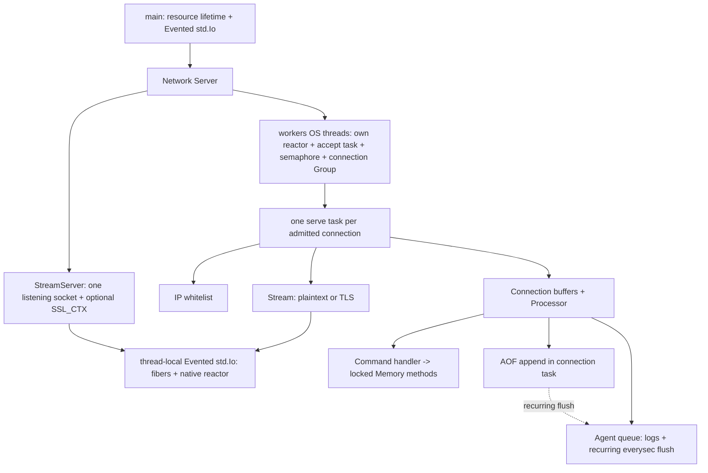
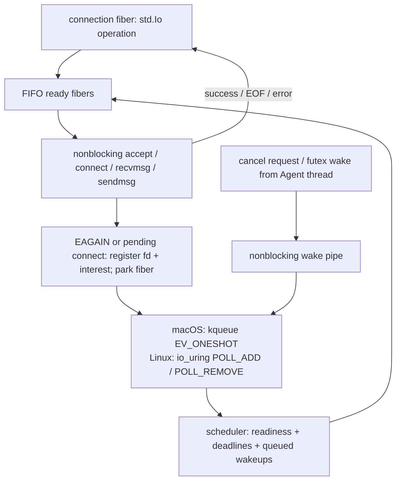

# Network architecture

This document describes the implemented network path, not a proposed design.
The runtime uses a custom Zig 0.17.1 `std.Io` backend with cooperative fibers,
kqueue on macOS, and io_uring on Linux. TLS uses OpenSSL memory BIOs; encrypted
socket traffic goes through the same reactor as plaintext traffic.

## Contents

- [Component boundaries](#component-boundaries)
- [Tasks, threads, and ownership](#tasks-threads-and-ownership)
- [Connection lifecycle](#connection-lifecycle)
- [Request and response flow](#request-and-response-flow)
- [Copy and allocation inventory](#copy-and-allocation-inventory)
- [TLS transport](#tls-transport)
- [Admission control and backpressure](#admission-control-and-backpressure)
- [Errors and shutdown](#errors-and-shutdown)
- [Implementation constraints](#implementation-constraints)
- [Verification and maintenance](#verification-and-maintenance)

## Component boundaries

| Component | Responsibility | Source |
| --- | --- | --- |
| Process entry point | Creates the I/O backend and shared resources; installs signal handlers; coordinates teardown. | [main.zig](../../src/main.zig) |
| Evented `std.Io` adapter | Owns fiber stacks, ready queue, timers, futures, groups, cancellation, futex waiters, and TCP operations. | [evented.zig](../../src/runtime/evented.zig) |
| Native reactor | One-shot descriptor readiness, bounded kernel waits, and stale-event suppression. | [reactor.zig](../../src/runtime/reactor.zig) |
| Network `Server` | Supervises native worker threads and their accept tasks, owns their shared transport, checks access, and runs connection tasks. | [network/server.zig](../../src/server/network/server.zig) |
| `StreamServer` | Owns the listening socket and optional shared TLS context; binds, accepts, and upgrades streams. | [stream_server.zig](../../src/server/network/stream_server.zig) |
| `Stream` / `StreamT` | Presents the same read/write/close API for plaintext and TLS; also exposes a buffered `std.Io.Reader` adapter. | [stream.zig](../../src/server/network/stream.zig) |
| Socket adapter | Uses `std.Io.net.Stream.read` and `std.Io.operate` network operations; handles partial writes. | [socket.zig](../../src/server/network/socket.zig) |
| TLS adapter | Drives handshakes, encryption, and decryption through OpenSSL input/output memory BIOs. | [secure.zig](../../src/server/network/secure.zig) |
| `Connection` | Owns receive/transmit accumulators and a fixed read buffer. | [connection.zig](../../src/server/network/connection.zig) |
| `Processor` | Extracts complete frames, parses commands, encodes responses, and compacts unread bytes. | [requests.zig](../../src/server/processing/requests.zig) |
| Command handler and storage | Execute commands synchronously in the connection task; storage methods provide their own locking. | [commands.zig](../../src/server/processing/commands.zig), [memory.zig](../../src/server/storage/memory.zig) |
| Access policy | Stateless IP whitelist verification, including rejection logging. | [access.zig](../../src/server/middleware/access.zig) |
| Background `Agent` | Serializes queued log work and recurring AOF flushes on an existing database background thread. | [agent.zig](../../src/server/background/agent.zig), [logger.zig](../../src/server/logger.zig), [aof.zig](../../src/server/storage/aof.zig) |

The network supervisor and former listener responsibilities live together:
there is no separately allocated array of listener objects. `StreamServer`
remains separate because socket/TLS lifecycle is reusable independently of
request processing. `Context` contains references to shared resources; copying
it does not copy the database, logger, or background queue.



Arrows describe calls or task creation, not transfers of ownership. The queue
arrow for AOF represents its scheduled flush, not command dispatch.

## Tasks, threads, and ownership

`main` uses `std.process.Init.io` for CLI/bootstrap work, then initializes
`Evented` **after daemonization**, and publishes its `std.Io` through
[runtime/io.zig](../../src/runtime/io.zig). Initializing after the final fork
avoids inheriting an invalid kqueue or retaining the parent's thread identity.
Daemon stdout/stderr are redirected to `/dev/null`, not left closed, so newly
opened reactor descriptors cannot be accidentally used by diagnostic output.
Daemon configurations still need absolute storage/certificate paths because
the existing daemonization code changes its working directory to `/`.
Each backend is initialized in place on its owner thread and must not be moved
or migrated. Network workers publish their own backend through the thread-local
runtime override; bootstrap and external background threads use the process
backend. Worker backends are destroyed on their owner threads after all their
connection tasks finish.

Existing unit tests use `std.testing.io` through the runtime adapter unless a
server worker installs its explicit thread-local native backend. The
separate `zcached-io-tests` executable directly constructs `Evented`, so native
backend coverage cannot accidentally be replaced by the testing backend.

`Server.run` binds once, then starts `config.workers` OS threads. Each thread
initializes its own `Evented` backend and uses `std.Io.Group.concurrent` to run
one accept task. These tasks accept from the **same** listening socket. Each
accept task has a local `std.Io.Semaphore` and a local group of
connection tasks. It cancels and waits for that group before returning, so the
semaphore cannot disappear while a connection still references it.

```text
main / Server.run
  owns StreamServer
  owns and joins worker threads
    +-- worker thread #0 / Evented #0
    |     acceptConnections #0
    |     owns semaphore #0
    |     owns connections Group #0
    |       +-- serve connection A
    |       +-- serve connection B
    +-- worker thread #1 / Evented #1
    |     acceptConnections #1
    |     owns semaphore #1
    |     owns connections Group #1
    |       +-- serve connection C
    +-- ... up to config.workers OS worker threads

separate existing Agent drain thread
  consumes immediate log tasks and delayed AOF flush tasks
```

Accept, connection, and worker-supervisor tasks are fibers on their worker's
owner OS thread. A pending accept/read/write/handshake parks its fiber, not an
OS thread. Different workers can execute commands in parallel across CPU cores;
shared storage, AOF buffers, and background queues retain their locking. The
main supervisor, existing Agent drain thread, and optional AOF rewrite thread
remain separate. Without a rewrite, the normal process has `workers + 2` OS
threads, independent of the number of admitted connections.

The adapter maintains a mutex-protected registry of live backends. A shared
`std.Io` futex wake scans native waiters across those backends and notifies each
affected reactor through its wake pipe; any remaining wake budget goes to OS
waiters. Registration and wake checks use each backend's waiter mutex, so an
unlock on one worker cannot lose a waiter parked on another worker. The registry
also protects backend lifetime during cross-thread wakeups.

Commands call storage directly from connection fibers, not through the Agent.
Within each worker, task execution is cooperative, not preemptive. TCP
accept/connect/read/write yield through the FIFO ready queue even when a
syscall could complete immediately, allowing other fibers and deadlines to
progress. Pure computation and synchronous filesystem calls can still delay
that worker's reactor.

### Native readiness and scheduling

The design adopts the one-shot completion/readiness architecture of the
[pinned Bun/TigerBeetle I/O code](https://github.com/oven-sh/bun/tree/e14a3af491ece8d1b0309e76ae3022b4fad91f16/src/io).
It is an independent implementation for Zig 0.17.1, not a vendored Bun
dependency or a claim of API/performance equivalence with TigerBeetle.



The kernel watches descriptors, **not fiber pointers or application byte
buffers**. Buffer reads/writes happen in the resumed fiber using nonblocking
syscalls. On Linux, monotonically generated registration IDs reject stale
completions after disarm/rearm; cancellation CQEs use a reserved ID. Read and
write interests are independent, and multiple accept fibers may wait on the
same listening descriptor.

The scheduler polls readiness without blocking while fibers are ready.
Otherwise it waits in the kernel until readiness, a wake-pipe event, or the
nearest deadline. There is no timer thread. External queue-thread wakeups use
the pipe; a full pipe already represents a pending wakeup. Futex value checking
and fiber registration are serialized with wakeups to prevent lost wakes.

Cancellation wakes a cancelable parked fiber and is delivered at its next
cancellation check. Blocked cancellation protection retains the request until
unblocked; delivery consumes it once, and `recancel` re-arms it. Future awaits
and group cancellation wait for cleanup. A completed group member is destroyed
immediately after switching off its stack; future result storage remains until
await/cancel. Native batches use the same fiber scheduler and drain pending
operations before returning a timeout/cancellation, so stack-owned operation
buffers cannot outlive their caller.

### Backend boundaries and memory

| Facility | Implementation |
| --- | --- |
| TCP IPv4/IPv6 listen, accept, connect, read, write | Nonblocking sockets; native reactor readiness; cooperative fibers. |
| Futures, groups, sleeps, native operation batches | Fiber scheduler and monotonic/selected-clock deadlines. |
| Mutexes, events, semaphores on reactor fibers | `std.Io` futex callbacks park/wake fibers. |
| Synchronization on the existing external threads | Synchronous OS futex/condition services; wake pipe notifies the reactor. |
| Filesystem, processes, clocks, randomness, socket close/shutdown | Reused synchronous `std.Io.Threaded` platform services with `.concurrent_limit = .nothing`; its task scheduler is not used. |
| DNS, UDP/datagram operations, Unix sockets, socketpair, sendfile | Not used by this server; explicitly logged and rejected rather than silently routed to a blocking network backend. |

This is a **network-evented, synchronous-filesystem hybrid**, not an
asynchronous disk engine or a complete implementation of every `std.Io`
network facility. AOF `everysec` remains on the Agent queue; synchronous AOF
append in a command can block the reactor.

Each spawned fiber and the scheduler reserve a 4 MiB virtual stack plus one
guard page. Page mappings are obtained without eager allocator poisoning:
physical pages are committed as touched. Overflow hits the lower guard page.
Context switches explicitly save/restore the C ABI's callee-saved registers and
floating-point control state on the suspended stack. They do not rely on the
inline standard-library switch that failed optimized Zig 0.17 tests. Native
regressions are exercised in both Debug and ReleaseSafe.
Task arguments/results are separate allocator-owned copies; their referenced
payloads remain governed by the existing caller/queue ownership rules. Active
groups do not retain stacks from completed connection tasks.

Readiness dispatch and deadline selection currently scan parked fibers. This
is not an O(1) per-event completion-pointer dispatcher; high connection counts
still need measurement. The backend currently supports macOS/Linux on aarch64
and x86_64. Linux requires usable io_uring with `NODROP` and `EXT_ARG` support;
denial by seccomp or unsupported features is an explicit startup error. There
is no fallback to Threaded network tasks or epoll.

### Ownership rules

| Resource | Owner and lifetime |
| --- | --- |
| Listening socket and shared `SSL_CTX` | `StreamServer`, owned by the network server; destroyed after its accept/connection groups finish. |
| Accepted socket and per-connection `SSL` / BIOs | The `accepted.stream` local in `serve`; closed on every exit path. |
| Stream value inside `Connection` | A shallow handle/context copy used for I/O, not a second resource owner. `Connection.deinit` frees buffers only. |
| Receive and transmit arrays | `Connection`; created after admission and TLS upgrade, freed when `serve` exits. |
| Parsing and encoding arenas | The connection's `Processor.protocol`; destroyed with the processor. |
| Semaphore permit | Reserved before `accept`; held through access verification, handshake, processing, and teardown. |
| Fiber stack / copied task closure | Evented backend; freed after task completion on the scheduler stack. |
| Logger task arguments | Queue-owned copies; string slice arguments are duplicated by the scheduler's existing cloning path. |
| AOF scheduled callback | Non-owning AOF pointer protected by a cancelable task handle; cancellation waits for an executing callback. |

Passing `Stream`, addresses, or `Context` by value copies metadata and pointers,
not their underlying byte buffers.

## Connection lifecycle

```mermaid
sequenceDiagram
    participant Run as Server.run
    participant Accept as acceptConnections
    participant IO as std.Io / socket
    participant Serve as serve
    participant TLS as OpenSSL memory BIOs
    participant Proc as Processor / Memory
    Run->>IO: bind + listen once
    Run->>Accept: spawn worker thread; start local accept task
    Accept->>Accept: wait for local semaphore permit
    Accept->>IO: accept
    IO-->>Accept: stream + peer address
    Accept->>Serve: connections.concurrent
    Serve->>Serve: verify IP whitelist
    opt TLS compiled in and enabled in config
        Serve->>TLS: upgrade + handshake through std.Io
    end
    Serve->>Serve: allocate Connection + Processor
    loop until EOF, error, or cancellation
        Serve->>IO: read through Stream
        Serve->>Proc: deframe + process complete requests
        Proc-->>Serve: encoded bytes appended to transmit accumulator
        Serve->>IO: writeAll pending response bytes
    end
    Serve->>Serve: destroy Processor, then Connection buffers
    Serve->>IO: free TLS state and close accepted socket
    Serve->>Accept: return semaphore permit
```

Admission happens before allocating protocol buffers. Whitelist verification
also precedes TLS handshake work. A failed connection-task spawn explicitly
closes the accepted stream and returns its permit.

TLS is selected for the entire listening socket: a TLS-capable binary with TLS
disabled uses plaintext. There is no STARTTLS command, protocol sniffing, or
simultaneous plaintext/TLS negotiation on one listener. The server initializes
TLS only when both the build option and runtime configuration enable it.

## Request and response flow

### Framing and ordering

The transport is a TCP byte stream, not a message transport. The outer frame
delimiter is `EXT_CHAR`, byte `0x03`, defined in
[network/consts.zig](../../src/server/network/consts.zig). For example:

```text
request:  *1\r\n$4\r\nPING\r\n\x03
response: +PONG\r\n\x03
```

1. `Connection.readPending` reads at most 4096 plaintext bytes per call into its
   fixed buffer, checks the aggregate receive limit, then appends them to the
   receive accumulator.
2. If that read contains no delimiter, it returns `IncompleteMessage`; `serve`
   keeps reading without discarding accumulated bytes.
3. `Processor.deframe` scans the accumulator and processes all complete frames
   in order. Each frame is a borrowed slice, excluding `0x03`.
4. Responses for those frames accumulate in the same transmit array.
5. A fully consumed receive array is cleared without freeing capacity. A
   trailing partial frame is copied to the start of the existing allocation.
6. `Connection.writePending` sends the transmit array with `Stream.writeAll`,
   then clears its length only after successful transmission.

Requests on one connection execute sequentially and their responses retain
that order. Different connections have no ordering guarantee. A read can
contain several requests or only part of one; one response can require several
socket writes.

The production request path calls `Stream.read` directly; it does **not** pass
through `Stream.Reader`. The buffered `std.Io.Reader` adapter is used by the E2E
client and stream tests. Its buffer is a separate client-side concern, not an
extra server-side receive accumulator.

### Plaintext byte path

```text
IN
kernel TCP receive buffer
  -> std.Io net_read -> Connection.buffer[4096]          [read destination]
  -> accumulator.appendSlice                           [payload copy]
  -> request slice + FixedBufferStream                  [borrow, no frame copy]
  -> parsed ZType strings                              [borrow input slices]
  -> Memory.put for stored keys / values                [owned database copy]

OUT
command result
  -> protocol Deserializer arena                       [encode / allocate]
  -> tx_accumulator.appendSlice + append(0x03)          [encoded-byte copy]
  -> Stream.writeAll -> std.Io net_write
  -> kernel TCP send buffer                            [kernel boundary]
```

The protocol's naming is historical: `Protocol.serialize` parses incoming
bytes; `Protocol.deserialize` encodes a response. Parsing allocates containers
in the serializer arena but `takeLineSlice` borrows string bytes directly from
the receive accumulator.

## Copy and allocation inventory

These are application-visible copies and allocations. Kernel, cryptographic,
and allocator implementation internals are not counted as exact operations.
In particular, this is **not** an end-to-end zero-copy design.

| Stage | What happens | Ownership / cost |
| --- | --- | --- |
| Socket receive, plaintext | The backend fills the fixed read buffer. | No intermediate application-owned socket buffer in this path. |
| Reactor readiness | Descriptor/interest and registration metadata pass through the kernel event queue. | No application payload buffer submitted to kqueue/io_uring; readiness is not a payload copy. |
| Fiber task arguments/results | Task argument bytes are copied into owned storage; a future result is copied out on await/cancel. | Pointer/slice arguments are shallow copies, not automatically duplicated payloads. |
| Receive accumulation | `appendSlice` copies newly read bytes; growth may relocate existing bytes. | Connection-owned heap array. |
| Frame extraction | `items[start..request_end]` borrows the frame. | No frame-sized allocation or copy. |
| Incomplete-tail compaction | `copyForwards` moves the unread suffix to offset zero. | Conditional in-place copy, only after consuming preceding frames. |
| Protocol parsing | String/line slices borrow input; arrays/maps/sets allocate container storage in an arena. | Not a deep copy of every request value. |
| Database `SET` | `Memory.put` deep-copies the value; a new key is duplicated. | Database allocator owns data independently of the network buffers. |
| Database `GET` | `Memory.get` returns a `ZType` by value, with referenced payloads still storage-owned. | Not an owned snapshot; see concurrency constraints below. |
| Response encoding | Scalars/strings are formatted into arena allocations; compound encoders repeatedly concatenate accumulated output. | Large collections can involve repeated copies of growing prefixes. |
| Transmit accumulation | The encoded response is copied to the transmit array; the frame delimiter is appended. | Connection-owned heap array. |
| Plaintext transmission | `writeAll` passes successive slices to the backend until all bytes are accepted. | No additional full-response application staging buffer. |
| TLS receive | Ciphertext is read into a 16 KiB local buffer, copied into an input memory BIO, then decrypted into the caller's buffer. | Additional TLS staging/BIO storage; see the TLS diagram. |
| TLS transmission | OpenSSL encodes records into an output BIO; `BIO_read` copies them into a 16 KiB local buffer before socket writes. | Additional record staging; not direct fd-based TLS. |
| Request/response logging | `utils.repr` allocates a CRLF-escaped representation; enqueue duplicates its string slice; the Agent formats it into the logger buffer. | Logging adds work and payload-sized copies even after zero-copy frame extraction. |
| Mutation AOF append | A temporary array copies `ZType` descriptors; a local encoder allocates command bytes; `AOF.append` copies them into its buffer. | Separate persistence copy path, synchronous during command execution. |

Protocol strings must not outlive the receive frame unless copied into a
different owner. For example, `SET` performs its database copy before
`deframe` can clear or move the accumulator.

### Memory budgeting

At initialization, a `Connection` contains a 4 KiB fixed buffer and requests
4 KiB initial capacity for each of its two dynamic arrays: approximately
12 KiB of raw buffer capacity, **excluding** object metadata, allocator
rounding, task/thread stacks, TLS state, and protocol arenas.

Both arrays retain capacity after normal processing. Parsing/response arenas
also belong to the connection. Although the protocol exposes `reset`, the
current `Processor` does not call it between requests. Consequently, arena
allocations can accumulate over a long-lived connection; neither receive
length nor the nominal 12 KiB starting size bounds its total memory.

Logging queues, database allocations, AOF buffers, and kernel socket buffers
are additional memory consumers. `max_memory` is a database storage check, not
a global cap on networking or process memory.

## TLS transport

OpenSSL never owns the network fd through `SSL_set_fd` in this implementation.
`SSL_set_bio` attaches two memory BIOs to each connection's `SSL`; `SSL_free`
releases that TLS state. The shared `SSL_CTX` is configured once by
`StreamServer`, with a minimum protocol version of TLS 1.3.

```mermaid
flowchart LR
    Peer["peer TCP socket"]
    Receive["std.Io net_read -> local ciphertext buffer (16 KiB)"]
    InBIO["BIO_write -> input memory BIO"]
    SSLRead["SSL_read -> Connection.buffer (plaintext)"]
    RX["receive accumulator"]
    TX["transmit accumulator (plaintext)"]
    SSLWrite["SSL_write -> output memory BIO"]
    Flush["BIO_read -> local ciphertext buffer (16 KiB)"]
    Send["std.Io writeAll"]
    Peer --> Receive --> InBIO --> SSLRead --> RX
    TX --> SSLWrite --> Flush --> Send --> Peer
```



`SSL_do_handshake`, `SSL_read`, and `SSL_write` may need more transport work.
The adapter:

- Clears OpenSSL's error queue before each SSL operation.
- Flushes pending output BIO bytes.
- On `SSL_ERROR_WANT_READ`, receives more ciphertext and fills the input BIO.
- On `SSL_ERROR_WANT_WRITE`, requires flushing to have made progress; otherwise
  returns `TLSNoProgress`.
- Treats other SSL errors as `TLSProtocolError`.

This also permits a read operation to send TLS control traffic. A received
TLS `close_notify` appears as `SSL_ERROR_ZERO_RETURN` and ends a read normally;
raw TCP EOF while TLS expects ciphertext is `TLSUnexpectedEof`.

Certificate/key paths, optional CA, and peer verification mode come from
`Config.TLSConfig`. The E2E `upgradeClient` helper deliberately disables server
certificate verification; it is a test convenience, not a production client
security policy.

## Admission control and backpressure

| Control | Implemented meaning |
| --- | --- |
| `workers` | Number of OS worker threads, each with its own reactor and one accept loop on the shared listening socket; default 4. |
| `max_clients` | Permits **per accept loop**; default 512. Idle connections and unfinished handshakes retain permits. |
| Aggregate admitted connections | At most `workers * max_clients` connection tasks, not a single global semaphore. Distribution among accept loops is not guaranteed fair. |
| Listen backlog | Requested `StreamServer.Options.kernel_backlog` defaults to 128; the OS may apply its own limits. It is not the number of active application tasks. |
| Read chunk | Fixed `CLIENT_BUFFER = 4096`; `config.client_buffer` is not used to size this network read buffer. |
| `max_request_size` | Caps the aggregate receive accumulator before append; default 10 MiB. Several pipelined frames can count against it together. |
| Transmit buffer | No corresponding hard response-byte limit in `Connection`. |
| Timeouts | No application-level read, write, idle-client, or TLS-handshake deadline. |
| Background queue | Dynamic immediate FIFO and delayed priority queue; its test capacity hook is not production admission control. |

The actual receive-size check is
`existing_len > max_size || read_size > max_size - existing_len`.
Despite a configuration comment describing zero as unlimited,
`max_request_size = 0` currently rejects any nonempty read. Operators should
configure a positive limit rather than rely on that comment.

An accept loop reserves a permit **before** accepting, so it may reserve one
while waiting for the next connection. Connections that complete the TCP
handshake can remain in the OS backlog until a permit is available.

A slow reader blocks that connection's `writeAll`; its permit remains occupied
and the task does not read more requests until its pending response is sent.
Other connections have independent tasks, but share backend capacity, CPU,
allocation resources, and storage locks. Therefore isolation is practical,
not an unconditional latency guarantee.

## Errors and shutdown

### Error handling

- `ConnectionAborted` during accept is retried after returning the permit.
- Other non-cancellation accept errors are logged and clear the global running
  flag, initiating shutdown.
- Whitelist rejection is logged by the access policy and closes the connection
  without allocating a processor or negotiating TLS.
- TLS, allocation, and non-normal read/write failures are logged and terminate
  that connection. `Canceled` propagates through task error returns.
- Incomplete frames remain buffered. EOF/reset closes the connection.
- Protocol/command errors generally use the protocol error writer and permit
  processing to continue; they are distinct from transport failures.
- Failed log enqueue is explicitly reported through `std.log`; logging is not
  a guaranteed durable audit trail.

### Shutdown order

SIGINT and SIGTERM only clear the atomic running flag. The main and worker
supervisors check it with a 100 ms sleep. Each worker cancels its accept group,
interrupting blocked network operations, and the accept task cancels its
connection group. The main supervisor joins every started worker before
destroying the shared listener or TLS context, including partial startup failure.

```text
signal -> running = false
  -> Server.run leaves its supervisor loop
  -> each worker cancels/waits its accept task
       -> each accept task cancels/waits its connection tasks
            -> Processor arenas freed
            -> Connection buffers freed
            -> TLS state freed + accepted socket closed
            -> semaphore permit returned
  -> worker backends destroyed on their owner threads; worker threads joined
  -> StreamServer listening socket + shared TLS context destroyed
  -> AOF scheduled flush canceled; running callback awaited
       -> outstanding rewrite thread joined
       -> final buffer write attempted; AOF resources closed
  -> Agent.stop wakes queue wait and joins the drain thread
  -> remaining shared storage/config/logger resources released
  -> Agent.deinit frees queued task arguments
  -> Evented scheduler, stacks, native reactor, wake pipe, and synchronous services destroyed
  -> allocators destroyed
```

The supervisor polling interval is not a maximum shutdown duration. Synchronous
command work, filesystem writes, uncancelable storage locks, and AOF rewrite
completion may delay it. Cancellation is cleanup-oriented: it does not
guarantee delivery of an already encoded response.

The server frees TLS state and closes the socket without calling
`SSL_shutdown`; it does not attempt an outbound TLS `close_notify` exchange.
That is distinct from recognizing a peer's incoming `close_notify`.

## Implementation constraints

The following points are important when interpreting the architecture:

1. **Framing is delimiter-based, not fully binary-safe RESP.** `deframe`
   searches raw bytes for `0x03`; the current bulk-string parser also extracts
   newline-delimited slices rather than consuming a declared binary byte count.
   Do not infer arbitrary binary payload support from the RESP-like syntax.
2. **Storage reads are not serialization snapshots.** `Memory.get` releases
   its shared lock before response encoding and returns borrowed payload
   references. Concurrent mutation can invalidate such references; the network
   architecture does not itself provide lifetime-safe snapshots. Serial
   network fiber execution reduces CPU-parallel access but does not change
   storage ownership or eliminate access from background threads.
3. **There is no transaction spanning database mutation and AOF append.**
   Commands mutate memory and then append their persistence representation.
   An AOF error does not imply that the memory change was rolled back.
4. **`everysec` is best-effort scheduling, not a durability deadline.**
   The recurring callback runs on the Agent queue and can wait behind other
   work. Its `flushLocked` writes bytes to the file but does not issue `fsync`;
   a successful response or flush must not be described as guaranteed
   stable-storage persistence. AOF rewrite still uses its separate thread.
5. **Logging is on the data path.** Every complete request and successful
   encoded response is represented for logging. Representation and queue
   cloning happen in the connection task, even though normal file logging
   runs later on the Agent. Queue shutdown can leave messages unexecuted;
   `Logger.deinit` flushes its own buffer, not every pending queue task.
6. **Limits are local, not a complete process budget.** Per-loop permits,
   receive lengths, and database memory checks do not bound all fiber stacks,
   response arenas, log copies, or TLS allocations.

These are descriptions of the current code, not guarantees added by this
documentation or promises of future optimizations.

## Verification and maintenance

Relevant automated coverage:

| Behavior | Tests |
| --- | --- |
| Actual native scheduling, same-thread futures, protected cancellation/recancel, external futex wakeups, immediate group stack release, TCP connect/accept/read/write, backpressure cancellation, batch deadlines | [runtime/evented.zig](../../src/runtime/evented.zig), run with `zig build test-io` |
| Native one-shot readiness, disarm/rearm, bounded waits | [runtime/reactor.zig](../../src/runtime/reactor.zig) |
| Fragmented/pipelined requests, idle client cancellation, permit release | [tests/network/server.zig](../../src/tests/network/server.zig) |
| Ephemeral-port binding, buffered reader behavior, transport errors | [tests/network/stream_server.zig](../../src/tests/network/stream_server.zig) |
| Receive accumulation, pending writes, size checks | [tests/network/connection.zig](../../src/tests/network/connection.zig) |
| Whitelist rejection and IP-only matching | [tests/server/access.zig](../../src/tests/server/access.zig) |
| Queued log ownership and large payload formatting | [tests/server/logger.zig](../../src/tests/server/logger.zig) |
| Delayed queue wakeup, cancellation synchronization, rescheduling | [tests/background/agent.zig](../../src/tests/background/agent.zig) |
| Queued AOF flush and cancellation before AOF destruction | [tests/server/aof.zig](../../src/tests/server/aof.zig) |
| Plaintext/TLS commands, large payloads, handshake/shutdown regressions | [tests/e2e/main.zig](../../src/tests/e2e/main.zig) |

```sh
zig build test --summary all
zig build test-io
zig build e2e
zig build
zig build -Dtls-enabled=true
zig fmt --check .
```

Tests cover concrete behavior; they do not prove zero-copy transfer, bounded
memory under indefinitely long sessions, an exact shutdown deadline, or
event-loop-scale performance. When changing the backend, frame ownership,
TLS buffering, task grouping, or admission policy, update both this document
and the corresponding regression tests.

### Port validation

Before native worker threads were added, on macOS/aarch64 the port passed the existing 186 unit tests, 100 TCP/TLS E2E
checks, and eight direct native-backend/reactor tests. Unit/E2E checks ran in
Debug and ReleaseSafe; native backend tests also passed in ReleaseFast. A paced idle-client check
measured **2 OS threads before and after 512 TCP connections**, and likewise
**2 threads with 128 incomplete TLS handshakes**. Separate clients still
received PONG; SIGTERM with these clients open exited successfully in about
0.13 s (TCP) and 0.07 s (TLS). RSS was approximately 16 MiB and 24 MiB
respectively. Daemon-mode PONG and shutdown also passed with absolute storage
paths. These are local ReleaseSafe-build observations, not capacity/SLA or
burst-admission guarantees; the configured listen backlog remains finite.
The two-thread counts describe that earlier single-reactor configuration, not
the current `workers + 2` threading model.

### Native worker validation

The native worker version passed 186 unit tests and 100 TCP/TLS E2E checks in
ReleaseSafe, plus nine direct native-backend/reactor tests in Debug, ReleaseSafe,
and ReleaseFast. The additional test exchanges 2,000 semaphore request/response
pairs between two owner threads with independent reactors and shared
`std.Io` synchronization.

A local Apple M2 loopback benchmark in ReleaseFast configured eight network
workers and observed ten OS threads: eight workers, the main supervisor, and
the Agent. With eight Zig client threads, no pipeline, 10-byte random keys,
20-byte values, AOF disabled, TLS disabled, and full request/response file
logging, each repeat completed 80,000 SET and 80,000 GET commands:

| Repeat | Elapsed | Commands/s | Sampled maximum RSS |
| --- | --- | --- | --- |
| 1 | 1.851 s | 86,440 | 45.0 MiB |
| 2 | 2.095 s | 76,372 | 47.0 MiB |
| 3 | 2.089 s | 76,592 | 47.7 MiB |

Median throughput was 76,592 commands/s, versus 27,421 commands/s in the earlier
single-reactor, two-thread process under the same client workload. These
same-host measurements were not taken on an exclusive machine and do not
establish maximum server capacity or a comparison against the old Threaded
network backend. The existing client checks response framing; full logs were
also audited for successful response statuses/shapes, and SET/GET probes
checked exact payloads.

The backend tests cross-compiled for x86_64-linux-musl and
aarch64-linux-musl. Linux runtime behavior was not exercised locally because
Docker Desktop was paused; cross-compilation is not runtime validation.
